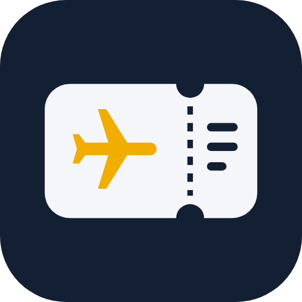

<h1 align="center">Aero</h1>

<b>항공권을 찍으면 공항까지 몇 시에 나가야 하는지 알려줘요.</b> 탑승권·e-티켓 한 장으로 출발 시각, 환승, 탑승권, 입국 준비까지.

  

버튼을 누르면 Aero.apk가 바로 받아져요. 📖 <a href="https://dlsdml99-create.github.io/aero/">앱 받기 · 설명 페이지</a>

---

## 소개

- **공항으로 나갈 시각**: 국제선 3시간 전 도착 기준으로 집을 나설 시각을 크게 보여줘요
- **찍기만 하면 자동 입력**: 탑승권 바코드와 글자를 폰 안에서 읽어 편명·좌석·예약번호·수하물을 채워요
- **출발 알림 3번 · 홈 화면 위젯 · 휴대폰 알람**
- **환승 안내**: 여유/빠듯함 판단, 해야 할 순서, 인천 터미널 이동
- **탑승권 크게 보기**: 최대 밝기, 인터넷 없이, 일행 탑승권까지
- **택시 기사에게 보여주기**: 현지 글자 공항 이름 + 그 나라 택시 앱 열기
- **도착지 날씨·시차·도착 시각 보내기**
- **입국 준비 체크리스트**: 나라별 비자·전자여행허가·입국카드 공식 링크, 여권 만료일 확인
- **인천공항 실시간**: 무료 인증키를 넣으면 체크인 카운터·게이트·지연·수하물 수취대

## 업데이트 내용

### v1.12
- 짧은 환승 빨간 경고와 놓쳤을 때 할 일, 귀국편까지 묶은 여행 전체 일정

### v1.11
- 구간마다 따로 넣은 환승편도 한 여정으로 묶어 환승 안내, 작은 화면 버튼 글자 깨짐 수정

### v1.10
- 보안: 앱 안에서는 바깥 스크립트를 불러오는 길을 완전히 막음

### v1.9
- 왼쪽 아래 버전을 누르면 앱 정보·업데이트 내용·개인정보, 새 버전이 나오면 버전 글씨가 노란색

### v1.8
- 쓰이지 않던 AI 연결 코드 제거 (항공권은 폰 안에서만 읽음)

### v1.7
- 처음 설치하면 빈 화면에서 시작 (예시가 내 항공권처럼 보이던 문제 수정), 알림 숫자는 내 항공권만

### v1.6 (첫 앱 버전)
- 항공권 사진·캡처·PDF를 폰 안에서 읽기, 출발 알림·위젯, 탑승권 보기, 택시 카드, 날씨, 입국 체크리스트, 공유로 넣기, 인천공항 실시간

## 안전

권한은 인터넷·알림·재부팅 후 알림 다시 걸기·알람 설정뿐이에요. 카메라·위치·연락처·저장공간 권한은 쓰지 않고, 항공권 정보와 사진은 폰 안에만 저장돼요.

데이터: [OurAirports](https://ourairports.com/data/) · OpenFlights(ODbL) · mwgg/Airports · 날씨 [Open-Meteo](https://open-meteo.com/)
